# 🐈 Mischievous Cat (こっそりネコ)

[日本語](README.md) | **English**

**Knock everything off the shelves while your owner isn't looking.**
Cups, vases, smartphones. You're just an adorable cat. …Probably.

## ▶ [Play now](https://kotaooka.github.io/mischievous-cat/)

- Just open it in your browser. No install, no sign-up (phone or PC)
- Add it to your home screen to launch it like an app. Once opened, it also works offline. When a new version is out, the title screen shows "tap to update"
- The game switches to English automatically when your device isn't set to Japanese. You can also switch languages under Settings (from the title or pause screen)
- Compete with everyone on the world ranking: how skillfully can you wreck the house in seven days?

## 📸 What it looks like

<table>
<tr>
<td align="center">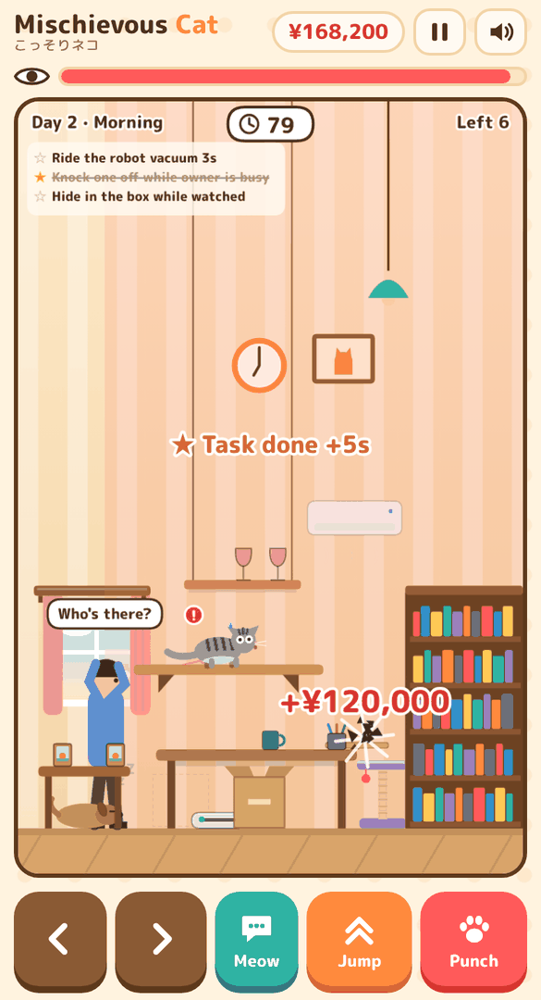 While the owner is on the phone…</td>
<td align="center">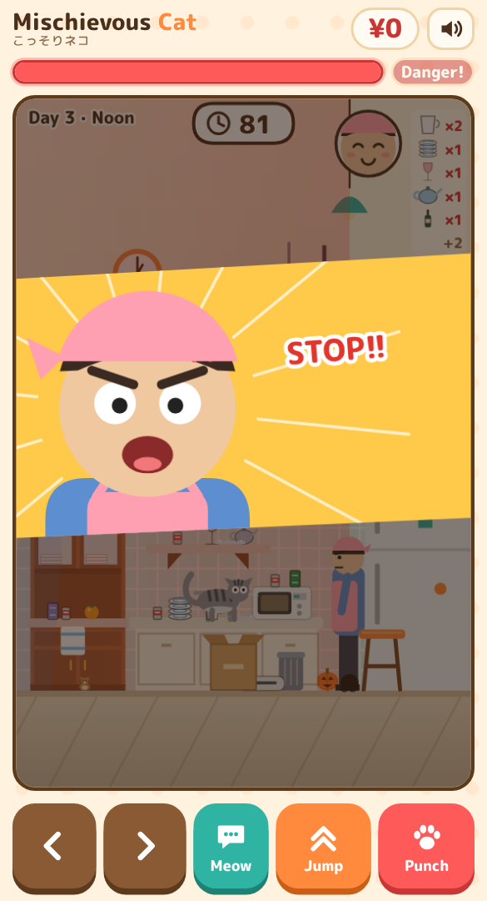 Caught!</td>
<td align="center">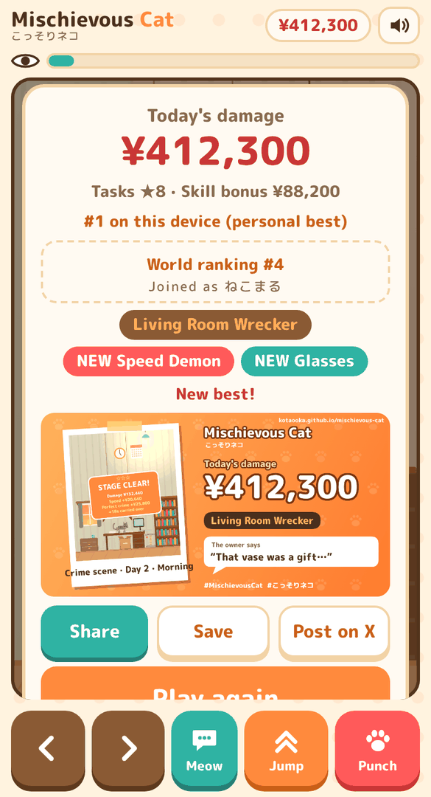 Your damage and a "crime scene photo"</td>
</tr>
<tr>
<td align="center">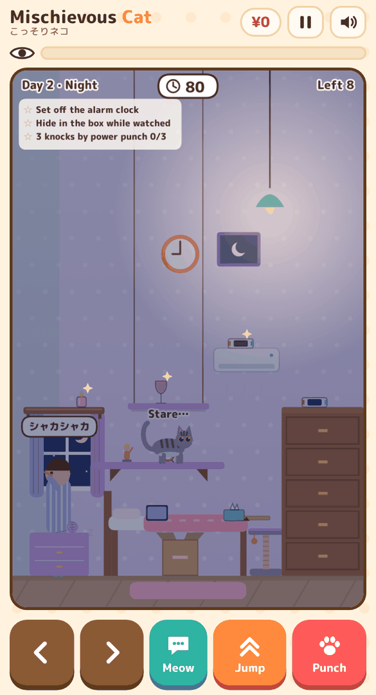 The bedroom. The owner is brushing their teeth</td>
<td align="center">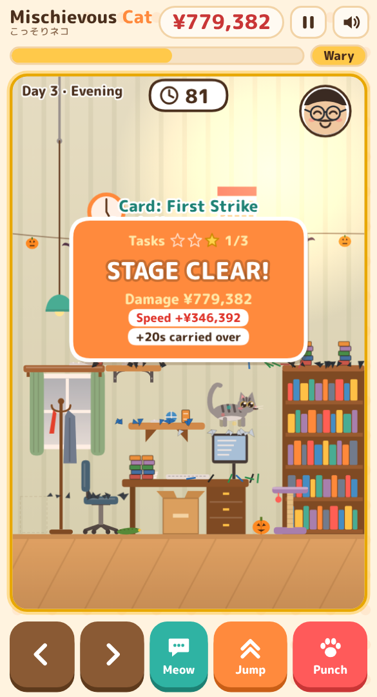 Stay unseen to earn skill bonuses</td>
<td align="center">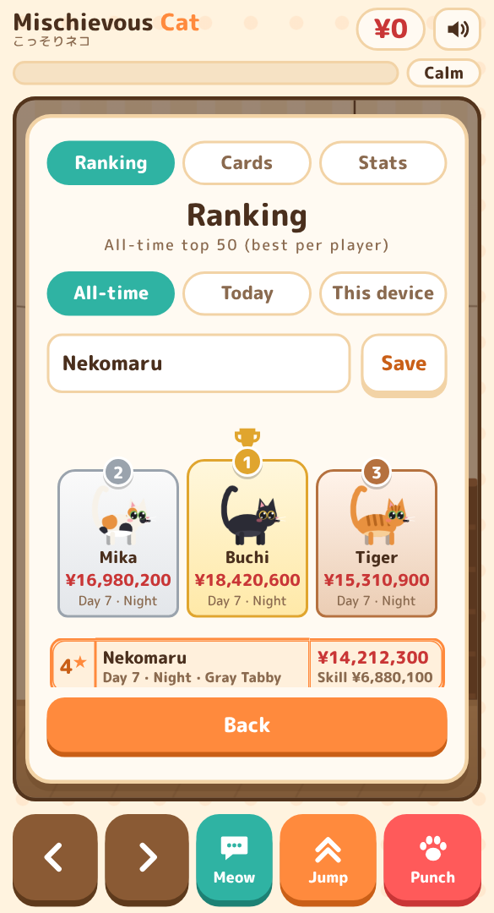 Battle it out on the world ranking</td>
</tr>
</table>

---

## 🐾 How to play in 30 seconds

1. **Walk up to something and punch it!** Knock things off tables and shelves to rack up "damage"
2. **If the owner sees you, you're done.** A "?" means trouble is coming, "!!" means they're watching. Hop off the furniture and act like a normal cat
3. **Knock everything off to clear the stage.** Morning, noon, evening and night make one day. Aim for **the third night** first. …What comes after is for you to find out

You can stop any time: the game auto-saves at the start of every stage, and the title screen offers "Continue" from that stage next time (or from that day's morning if you got caught). "Continue" also shows how many stages are left in that day. If you get caught on day 1, you can retry that stage.

Walking, jumping, meowing and eating are all "normal cat things", so you won't get in trouble for them. You only get in trouble when you're **caught in the act**.

## 🎮 Controls

| Action | Phone | PC |
|---|---|---|
| Walk | ＜ ＞ at the bottom | ← → / A D |
| Jump | Jump | Space / ↑ / W |
| Punch (hold for a mega punch) | Punch | Left click / Z |
| Sneak (walk while holding punch) | Punch + ＜ ＞ | Hold Z + ← → |
| Meow (hold for a long one, tap 3 times for "mew mew mew!") | Meow | Right click / X |
| Pause | ⏸ top right | Esc / P |

On PC, Enter (or A on a gamepad) presses PLAY on the title and Play again on the result screen. Resuming from pause counts down 3-2-1 first.

Gamepads work on PC too (D-pad/stick move, A jump, X or B punch, Y meow, START pause). Volume, vibration, mirrored buttons and reduced effects (no screen shake, zoom or flashing) are under **Settings**.

Prefer playing without the buttons? Turn on **Touch stick** under **Settings**. **Wherever you touch the game screen becomes a stick**: slide left/right to walk, flick up to jump, tap to punch (the cat turns toward the side you tap), hold still for a mega punch or scratching, and tap the cat to meow.

## 💡 Tips

- **Sneak up.** Walk while holding punch to creep low and slow. Being seen on furniture raises suspicion less, and foil traps are quieter. Release for a normal punch (charge a mega punch standing still)
- **Strike between patrols.** Stomping footsteps mean the owner is coming back
- **Distract with a meow.** The owner looks where the cat is facing. Get up to mischief on the other side
- **Wait until the owner is busy.** While they're on the phone, cooking, reading or brushing their teeth, they barely notice anything
- **Stare at the camera, then knock it off.** Stand still next to an item and the cat stares at you. Punch now for a "Guilty!" bonus
- **Keep knocking things off unseen for a "Sneaky" streak bonus.** The bonus grows with every item
- **Skill is what raises your score.** Item prices are almost fixed per stage. The difference comes from chain, sneaky, guilty and trick bonuses (knocking things down with the yarn ball or the chicken), plus the speed (time left) and perfect crime (suspicion under 30%) bonuses on each stage clear
- **Don't give up when you're spotted.** Up to twice per stage, dive into the cardboard box, onto the cat tower, or up on top of the bookshelf or higher within 3 seconds to escape
- **Sparkles, arrows or claw marks?** Something is there. There are no written instructions. Go and find out

<table>
<tr>
<td align="center">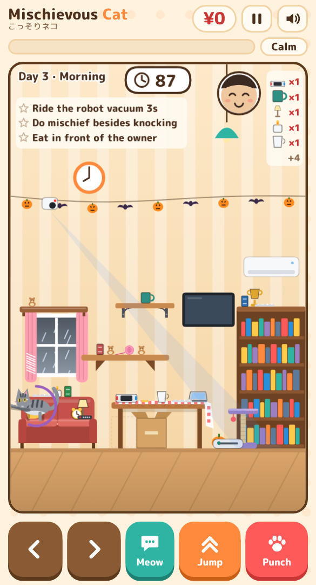 Hold punch where the claw mark appears</td>
</tr>
</table>

## 🏠 A day in the house

A day is four stages: morning, noon and evening in rooms that change each day, then a **special night**. Seven days in all (28 stages).

We won't spoil what lies past the third night. Just a few hints:

- **There is more than one ending.** Sneaky or destructive, the owner is keeping track of what kind of cat you were
- **Read the owner's diary.** One line a night. The house changes a little, too
- **There are rooms you haven't seen yet.** Some of them outside
- **The owner and the cat may not be alone in this house.** Things that scurry across the floor, things that swoop from the sky…
- What awaits past **the seventh night** is for you to see

Want every number and rule? See the [detailed rules](docs/rules.md) (Japanese, **spoilers**).

| Day | Morning | Noon | Evening | Special night |
|---|---|---|---|---|
| 1 | Living room | Kitchen | Study | **Dinner guest night** (two watchers, lots of glasses) |
| 2 | Garden | Kid's room | Bathroom | **??? night** (it's awfully dark tonight…) |
| 3 | ??? | ??? | ??? | **??? night** (the owner seems to have a plan) |
| 4–7 | ??? | ??? | ??? | ??? |

Each room has its own watcher: the owner, a kid (fast but short-sighted), grandma (slow, but glances back while walking) or dad (keeps looking up at the shelves). The weather changes every day too (and not just sun, clouds, rain and snow); on rainy days the owner stays in and comes back sooner.

<table>
<tr>
<td align="center">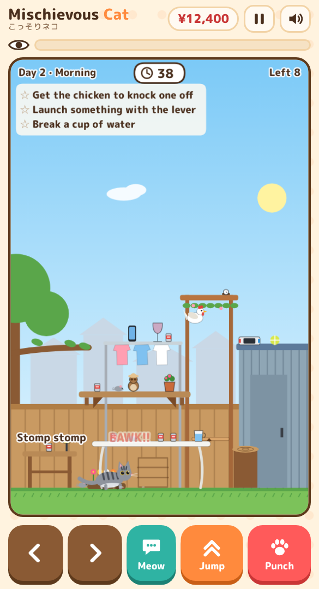 BAWK! The chicken takes off</td>
<td align="center">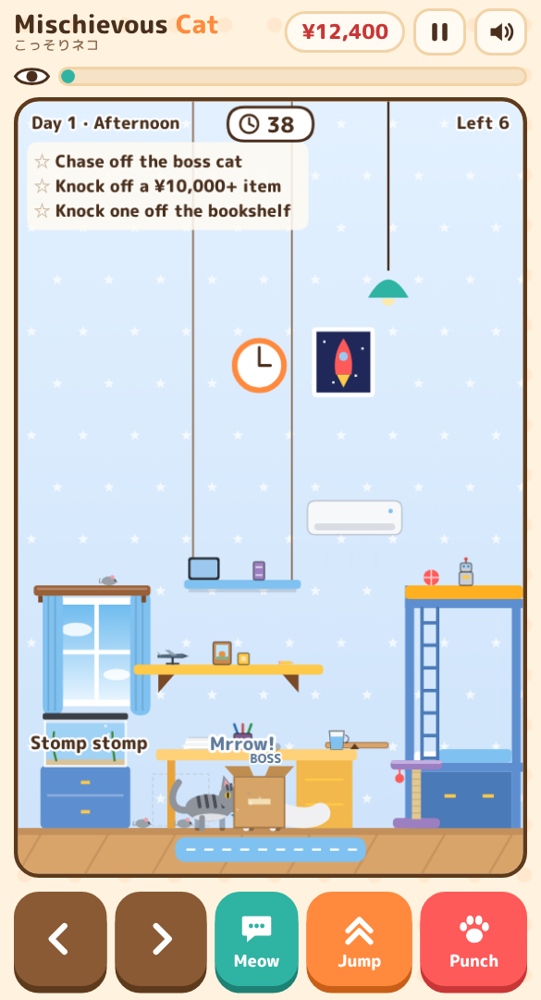 Paw fight with the boss cat</td>
<td align="center">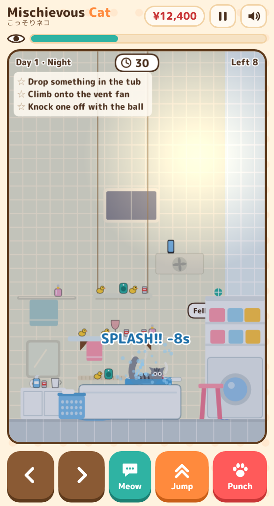 Fall in the bath, get soaked</td>
</tr>
<tr>
<td align="center">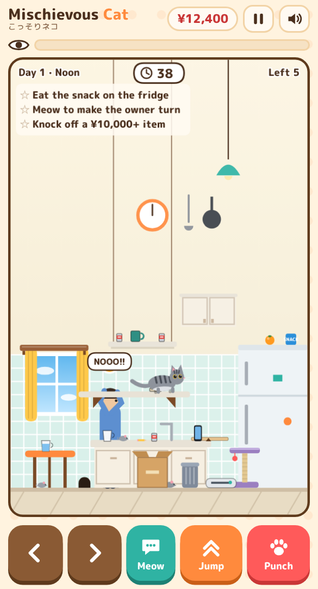 A mouse freezes the owner</td>
<td align="center">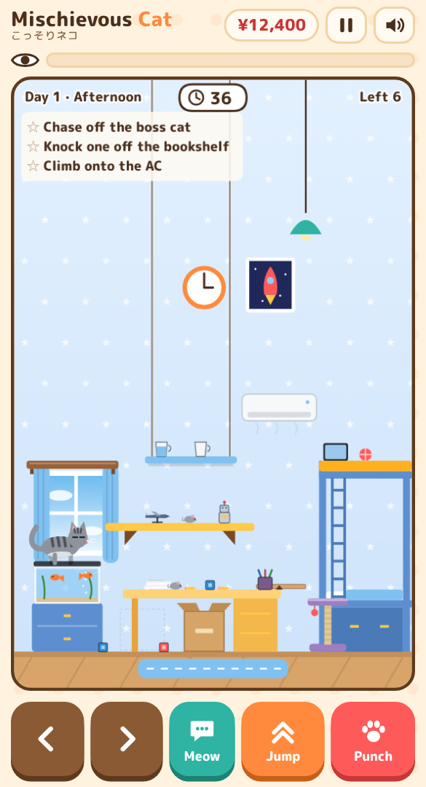 Paw at a fish near the surface</td>
<td></td>
</tr>
<tr>
<td align="center">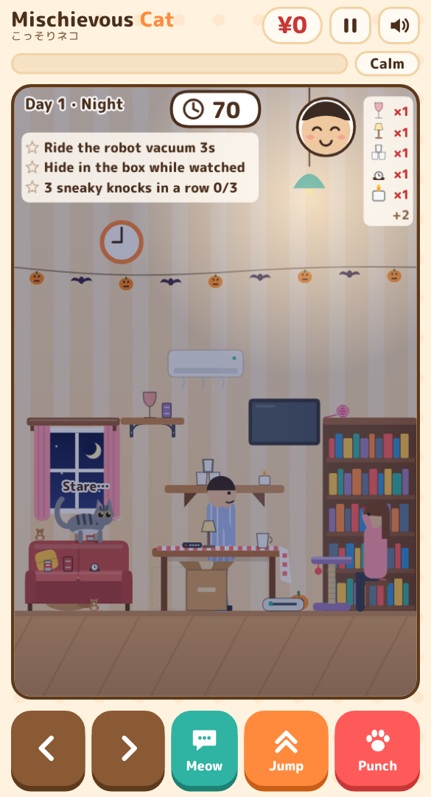 Dinner guest night</td>
<td align="center">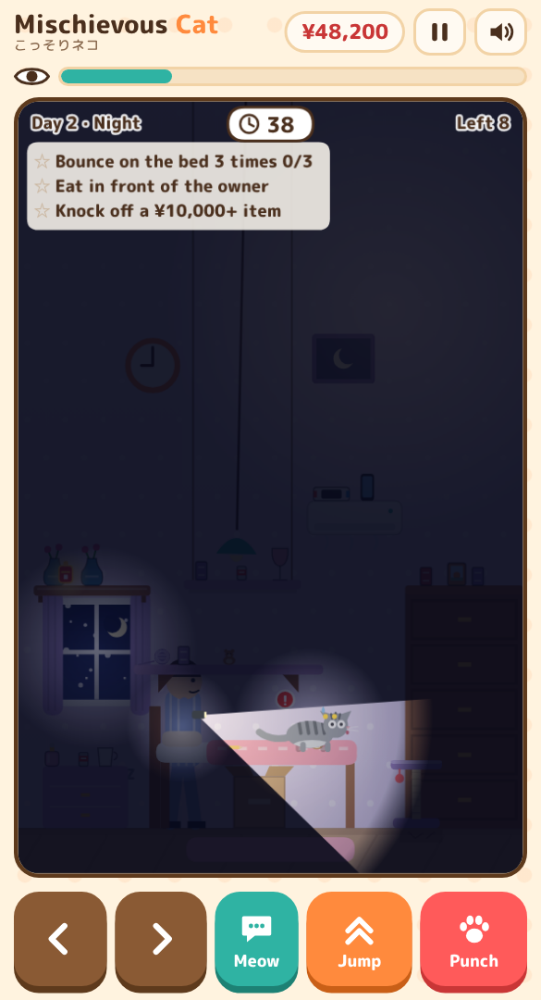 One night, the whole house goes dark…?</td>
<td></td>
</tr>
<tr>
<td align="center">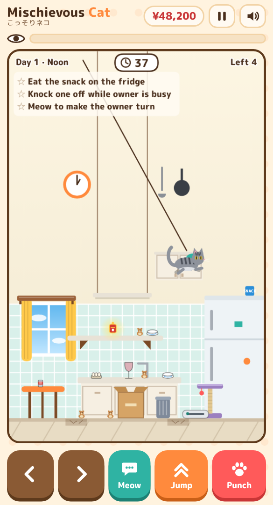 Swinging on the lamp</td>
<td></td>
<td></td>
</tr>
</table>

Every room has its own furniture (a sofa in the living room, a cupboard and microwave in the kitchen, a desk chair in the study, a vanity and a headboard shelf in the bedroom, a bunk bed in the kids' room…) and its own set of places to stand. The wall shelves and the air conditioner also move from stage to stage.

As stages go on, pricey items start appearing up high (hanging shelf, curtain rail, air conditioner). New ways to make mischief appear little by little, too: a rolling yarn ball and scratching spots.

## 🐱 The cats

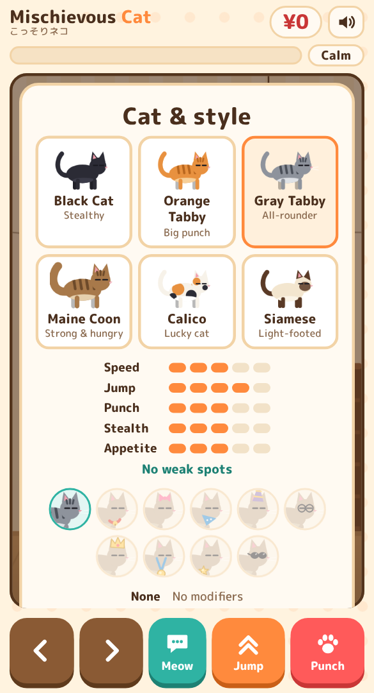

| Cat | Strength | How to unlock |
|---|---|---|
| Gray Tabby | All-rounder | From the start |
| Orange Tabby | Big punch | From the start |
| Black Cat | Hard to spot | Knock something off and clear a stage with suspicion under 20% |
| Maine Coon | Strong & hungry (low jump) | Topple furniture in any room (bookshelf avalanche, etc.) |
| Calico | Lucky cat (pricey items show up more) | ¥1,000,000 damage in a single run |
| Siamese | Light-footed (best jumper, quiet steps) | Reach the ending |

## 🏆 Rankings and mischief cards

- **World ranking (All-time)**: ranked by one run's damage. Clearing day 7 finishes the game, and among finishers the skill bonuses decide the order. Register a nickname on the result screen to join the top 50 of all players (one entry per device). A record is sent only when you beat your personal best, and a new nickname appears the next time you do
- **Today's ranking**: a ranking for today only (Japan time). Each run is sent to both All-time and Today whenever it beats your best there
- **Send on LINE**: sends the text and the link (the image share sends only the picture on LINE). On PC, Share copies the image to the clipboard and opens the X post window, so paste it into the post
- **Records**: one screen from the title with tabs for Ranking, Cards and Stats
- **Big ones**: each room has one way to bring a whole piece of furniture down (bookshelf avalanche, fridge avalanche…). Everything on top falls and the owner freezes for a moment. The Cards tab tells you how
- **Mischief cards**: 72 cards (some per run, some lifetime), each collected with a photo of the moment you first pulled it off. The Cards tab also shows how to get the ones you are missing
- **This device**: your own top 10
- **Toy camera**: press Share or Send on LINE on the results screen to get the Toy camera accessory. While wearing it, your share image becomes a WANTED poster
- **Accessories**: unlocked by specific cards ("Meow Decoy" for the bell collar, "Boss Beaten" for the bandana, and so on — the locked pill shows the card). Each gives a small bonus (punch +15%, jump +10%…); switching one on the title screen updates the stat pips. How you earned it stays listed under its bonus
- **Titles**: the title on the result screen is decided by one run's damage (five ranks)
- **Crime scene photo**: a close-up of the cat at the moment you're caught becomes a Polaroid (no HUD in the shot), with a one-line pitch and where to play. Tap the photo on the result screen to see it big. Share it with `#MischievousCat`
- **Day restarts**: from Day 2 on, the result screen offers "Continue from Day N morning". Damage, stars and charms go back to that morning, and the ranking shows how many restarts you used
- **Bad records**: unsigned records and impossible scores don't appear in the ranking

## ❓ FAQ

- **Does it cost anything?** No. There are no ads either
- **No sound?** Check the speaker button at the top right. On iPhone, silent mode can mute it
- **No vibration (Android)?** If **Touch feedback** (Settings → Sound → Vibration & haptics) is set to 0, browsers cannot vibrate the phone. Raise it a little (confirmed on Xperia / Chrome)
- **I updated, but it looks the same.** Close it and open it again (an older version may still be saved for offline play)
- **What about my data?** Your records stay on your device. Only when you join the world ranking are your nickname and record sent

---

The full rulebook with every number (time limits, bonus rates, item prices, title conditions) is in Japanese: [docs/rules.md](docs/rules.md).
