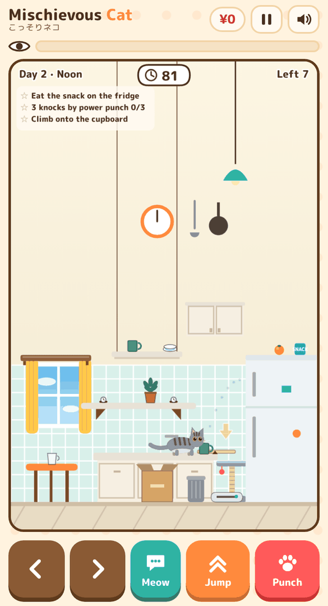
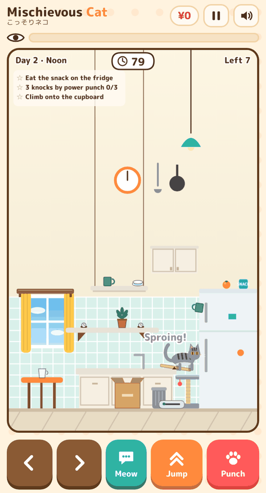

# 🐈 Mischievous Cat (こっそりネコ)

[日本語](README.md) | **English**

**Knock everything off the shelves while your owner isn't looking.**
Cups, vases, smartphones. You're just an adorable cat. …Probably.

### ▶ [Play now](https://kotaooka.github.io/mischievous-cat/)

- Just open it in your browser. No install, no sign-up (phone or PC)
- Add it to your home screen to launch it like an app. Once opened, it also works offline
- The game switches to English automatically when your device isn't set to Japanese. You can also switch languages on the title or pause screen
- Compete with everyone on the world ranking

## 📸 What it looks like

<table>
<tr>
<td align="center"> While the owner is on the phone…</td>
<td align="center"> Caught!</td>
<td align="center"> Your damage and a "crime scene photo"</td>
</tr>
<tr>
<td align="center"> Night. The owner is brushing their teeth</td>
<td align="center"> Stay unseen to earn skill bonuses</td>
<td align="center"> Battle it out on the world ranking</td>
</tr>
</table>

---

## 🐾 How to play in 30 seconds

1. **Walk up to something and punch it!** Knock things off tables and shelves to rack up "damage"
2. **If the owner sees you, you're done.** A "?" means trouble is coming, "!!" means they're watching. Hop off the furniture and act like a normal cat
3. **Knock everything off to clear the stage.** Morning, noon, evening and night make one day. How many days can you last?

Walking, jumping, meowing and eating are all "normal cat things", so you won't get in trouble for them. You only get in trouble when you're **caught in the act**.

## 🎮 Controls

| Action | Phone | PC |
|---|---|---|
| Walk | ＜ ＞ at the bottom | ← → / A D |
| Jump | Jump | ↑ / W |
| Punch (hold for a power punch) | Punch | Space / Z |
| Meow | Meow | X |
| Pause | ⏸ top right | Esc / P |

Want to play one-handed? Turn on **One-hand** on the title screen. Tap a spot or an item and the cat **finds its own way there, jumping as needed**, then punches the item (long tap for a power punch). Tap the boss cat, the chicken, a mouse or the fish tank to paw at it. Swipe up to jump; pressing any button takes back manual control.

## 💡 Tips

- **Strike between patrols.** Stomping footsteps mean the owner is coming back
- **Distract with a meow.** The owner looks where the cat is facing. Get up to mischief on the other side
- **Wait until the owner is busy.** While they're on the phone, cooking, reading or brushing their teeth, they barely notice anything
- **Stare at the camera, then knock it off.** Stand still next to an item and the cat stares at you. Punch now for a "Guilty!" bonus
- **Keep knocking things off unseen for an "Unseen" streak bonus.** The bonus grows with every item
- **Don't give up when you're spotted.** Once per stage, dive into the cardboard box or onto the cat tower within 3 seconds to escape
- **Sparkles, arrows or claw marks?** Something is there. There are no written instructions. Go and find out

<table>
<tr>
<td align="center"> A dotted line and an arrow…?</td>
<td align="center"> Jump on the board — Sproing!</td>
<td align="center"> Hold punch where the claw mark appears</td>
</tr>
</table>

- **Cat-meme moments included.** Break something pricey and the cat hops for joy; a big chain sends it to space. Watch its face when it gets caught. Stand still for a bit and it starts vibing to the music
- **Books, pencils, cans and toy mice are free-for-all clutter.** Knock them to the floor for "Mess" damage. The owner crouches to tidy up, and only looks at their feet while doing it
- **Mouse on the loose? Bop it.** Mice pop out of a hole now and then and dash around the floor. Bop one for extra time. Chase it toward the owner and they freeze with a scream (your chance!)
- **Don't let the boss cat win.** It knocks things off first and steals the damage. Land 3 paw hits and it runs away. If the owner catches it, it gets scolded and leaves
- **You can walk in front of the bookshelf and the fridge.** The cat tower stands in front of the bookshelf
- **Hungry? Meow.** A cute meow next to the owner might get you food (= more time)

## 🏠 Seven rooms

One day takes you through the whole house, from the living room in the morning to the bedroom late at night.

| Time | Room | Notes |
|---|---|---|
| Morning 7:00 | Living room | You can ride the robot vacuum. A dog is sleeping, so be quiet |
| Morning 9:00 | Garden | A noisy chicken. Startle it and it flaps up and shoves things off the shelves |
| Noon 12:00 | Kitchen | A snack sits on the fridge. Plenty of plates and eggs |
| Afternoon 15:00 | Kid's room | A goldfish tank and the neighbor's boss cat. The kid does the patrolling |
| Evening 17:00 | Study | Walk across the keyboard and… the owner's work is gone |
| Night 20:00 | Bathroom | Fall into the bathwater and you're soaked (less time, big fuss). Cross on the lid and the rim |
| Late night 22:00 | Bedroom | The bed is bouncy. Knock off the alarm clock for chaos |

<table>
<tr>
<td align="center"> BAWK! The chicken takes off</td>
<td align="center"> Paw fight with the boss cat</td>
<td align="center"> Fall in the bath, get soaked</td>
</tr>
<tr>
<td align="center"> A mouse freezes the owner</td>
<td align="center"> Paw at a fish near the surface</td>
<td></td>
</tr>
</table>

As stages go on, pricey items start appearing up high (hanging shelf, curtain rail, air conditioner). New ways to make mischief appear little by little, too: a lever, a rolling yarn ball and scratching spots.

## 🐱 The cats

| Cat | Strength | How to unlock |
|---|---|---|
| Gray Tabby | All-rounder | From the start |
| Orange Tabby | Big punch | From the start |
| Black Cat | Hard to spot | Clear a stage while keeping suspicion under 50% |
| Maine Coon | Strong & hungry (low jump) | Knock off 5 heavy items in total (mug, vase, game console) |
| Calico | Lucky cat (pricey items show up more) | Over ¥100,000 damage in a single run |

## 🏆 Rankings and titles

- **World ranking (All-time)**: register a nickname on the result screen to join the top 50 of all players (one entry per device). A record is sent only when you beat your personal best, and a new nickname appears the next time you do
- **Today's ranking**: a ranking for today only (Japan time). Each run is sent to both All-time and Today whenever it beats your best there
- **This device**: your own top 10
- **Titles**: 35 of them, and how to earn them is a secret. Collecting them unlocks **accessories** like a bell collar, a ribbon and a crown
- **Crime scene photo**: the moment you're caught becomes a Polaroid. Share it with `#MischievousCat`

## ❓ FAQ

- **Does it cost anything?** No. There are no ads either
- **No sound?** Check the speaker button at the top right. On iPhone, silent mode can mute it
- **I updated, but it looks the same.** Close it and open it again (an older version may still be saved for offline play)
- **What about my data?** Your records stay on your device. Only when you join the world ranking are your nickname and record sent
