# 🐈 こっそりネコ（Mischievous Cat）

**日本語** | [English](README.en.md)

**飼い主の目を盗んで、家じゅうのものを落とせ。**
コップも、花瓶も、スマホも。あなたはただの「かわいいネコ」です。……たぶん。

### ▶ [いますぐ遊ぶ](https://kotaooka.github.io/mischievous-cat/)

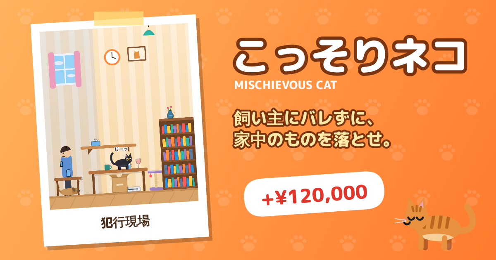

- ブラウザで開くだけ。インストール・登録は要りません（スマホでも PC でも）
- ホーム画面に追加すると、アプリのように起動できます。一度開けばオフラインでも遊べます
- 遊んだ記録は、みんなのランキングで競えます
- 英語にも対応しています。端末の言語が日本語以外なら英語で始まり、タイトル画面とポーズ画面でいつでも切り替えられます

## 📸 こんなゲームです

<table>
<tr>
<td align="center">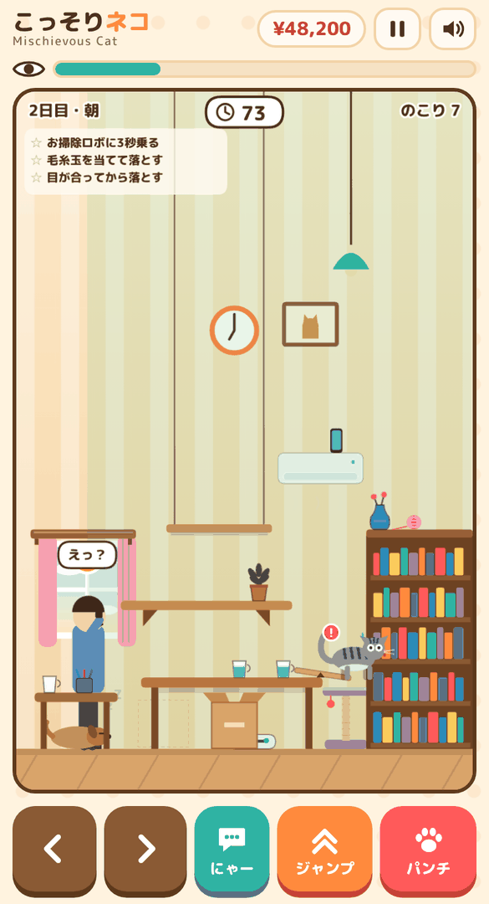 飼い主が電話に夢中なうちに……</td>
<td align="center">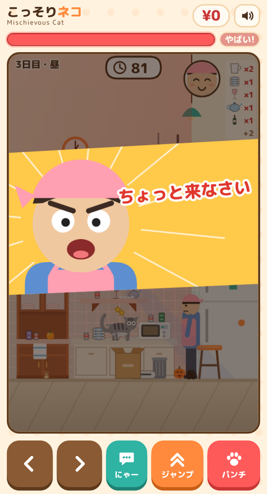 見つかった！</td>
<td align="center">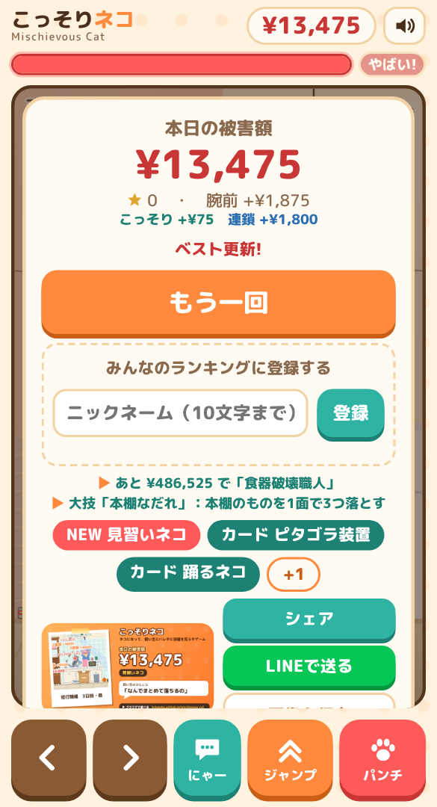 被害額と「犯行現場写真」</td>
</tr>
<tr>
<td align="center">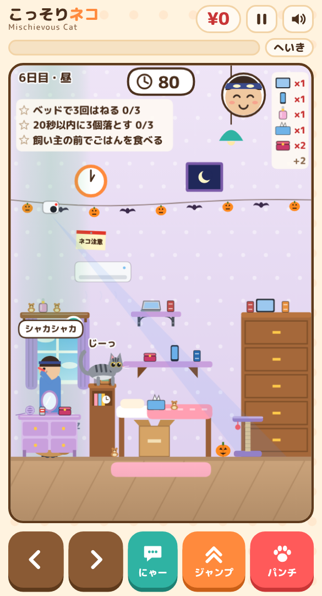 夜の寝室。飼い主は歯みがき中</td>
<td align="center">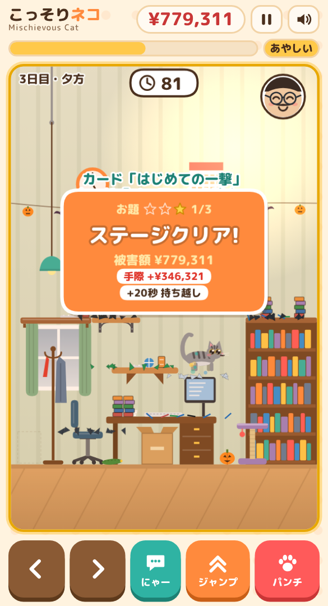 ばれずに片付けると腕前ボーナス</td>
<td align="center">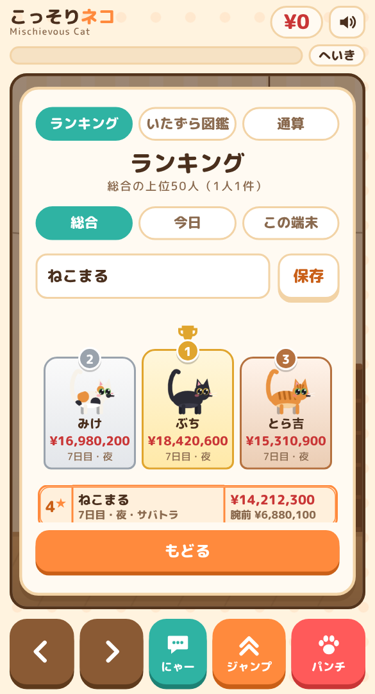 みんなのランキングで勝負</td>
</tr>
</table>

---

## 🐾 30 秒でわかる遊び方

1. **ものの横まで歩いて、パンチ！** テーブルや棚のものを床へ落とすと「被害額」がたまります
2. **飼い主に見られたらアウト。** 「？」が出たら要注意、「!!」は監視中。家具から降りて、ふつうのネコのふりをしましょう
3. **部屋のものを全部落とせばクリア。** 朝・昼・夕方の 3 部屋と「とくべつな夜」で 1 日。3 日目の夜を越えるとエンディング、そのあとも続けられます

床を歩く、ジャンプする、鳴く、ごはんを食べる。これは「ネコとしてふつう」なので、見られても怒られません。怒られるのは**いたずらの現場を見られたときだけ**です。

## 🎮 操作

| やること | スマホ | PC |
|---|---|---|
| 歩く | 画面下の ＜ ＞ | ← → / A D |
| ジャンプ | ジャンプ | ↑ / W |
| パンチ（長押しで強パンチ） | パンチ | Space / Z |
| 鳴く | にゃー | X |
| ひとやすみ | 右上の ⏸ | Esc / P |

PC はゲームパッドでも遊べます（十字キー／左スティックで移動、A ジャンプ、X か B パンチ、Y 鳴く、START ポーズ）。音量・振動・ボタンの左右反転は、タイトル画面の「**設定**」で変えられます。

片手で遊びたいときは、タイトル画面で「**かたて操作**」を ON に。行きたい場所やものをタップすると、ネコが**自分でジャンプしながら**そこまで行き、ものならパンチします（長押しタップで強パンチ）。ボス猫・ニワトリ・ネズミや水槽をタップすると、そこへ向かってパンチします。上へスワイプでジャンプ、ボタンを押せばいつでも手動に戻ります。

## 💡 うまくなるコツ

- **見回りの合間がチャンス。**「ドタドタ」という足音は、飼い主が戻ってくる合図です
- **「にゃー」で気をそらす。** 飼い主はネコが向いている側を見ます。その隙に反対側でいたずら
- **飼い主の「ながら」を狙う。** 電話・料理・読書・歯みがきに夢中な間は、見える範囲がぐっとせまくなります
- **カメラ目線で落とすと「確信犯」。** ものの横でじっとしていると、ネコがこっちを見つめます。そのままパンチ！
- **ばれずに落とし続けると「ノーマーク」ボーナス。** 落とすたびに上乗せが大きくなります
- **見つかっても、あきらめない。** 1面に1回だけ、3秒以内にダンボールかキャットタワー、または本棚の上より高い所へ逃げ込めばセーフ
- **キラキラ、矢印、爪あとのマーク**が出たら、そこに何かがあります。言葉の説明はありません。触って確かめてみてください

<table>
<tr>
<td align="center">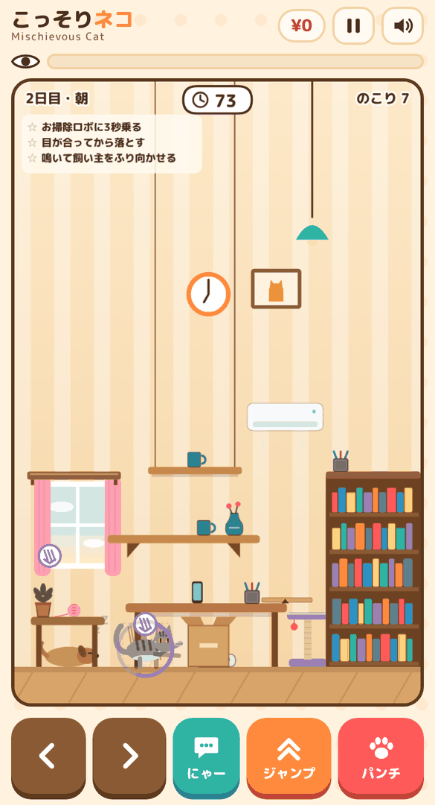 爪あとマークの場所で長押し</td>
</tr>
</table>
- **猫ミームっぽい瞬間もあります。** 高いものを割るとぴょんぴょん跳ね、大きな連鎖や 10 万円以上のものでは立ち上がって踊ります。見つかったときの顔（5 通り）にも注目。しばらく止まっていると、BGM に乗ってきます
- **赤いお守りを見つけたら拾っておこう。** ときどきどこかの段に落ちています。持っていれば、見つかってもそのステージの続きから 1 回だけやり直せます
- **本・鉛筆・空き缶・ぬいぐるみは散らかし放題。** 床に落とすと「散らかし」で被害額が増えます。飼い主はかがんで片付けますが、そのあいだは足もとしか見ていません
- **ネズミが出たら、パンチで退治。** ときどき穴から出てきて床を走り回ります。退治すると時間が増えます。飼い主のほうへ追い込むと、飼い主が悲鳴を上げて固まります（そのすきに！）
- **ボス猫には負けないで。** 先にものを落として、被害額を横取りしていきます。ネコパンチを 3 回当てると逃げていきます。飼い主に見つかったボスは叱られて退散
- **本棚や冷蔵庫の前も歩けます。** キャットタワーは本棚の前にあります
- **飼い主の足もとで「すりすり」。** 床でじっと寄りそうと、怪しまれ度が下がって、飼い主も足を止めます
- **リモコンを踏むとテレビがつく。** 飼い主もお客さんも、しばらく画面に夢中です
- **テーブルの右端のクロスを引くと……** テーブルの上のものがまとめてすべり落ちます
- **吊り照明に飛びつける。** 吊り棚から飛びついて左右でこぎ、ジャンプで手を離すと遠くまで飛べます
- **棚の端にものを集めて、端に乗ると……** ガタン！ 棚が傾いて全部すべり落ちます
- **きしむ床は、パンチを押しながら歩く。** 走ると「ギシッ」と鳴って飼い主が振り向きます。パンチを押している間はゆっくり歩けて音が出ません
- **2 日目からは罠に注意。** アルミホイルを踏むと大きな音、両面テープは足がくっつきます。3 日目からはペットカメラが首を振って見張っています
- **きゅうりにはびっくり。** うっかり近づくと垂直に飛び上がります。うまく使えば高い所へのジャンプ台に
- **チュールの誘惑。** 飼い主がチュールを振ると、床のネコは吸い寄せられます。食べれば時間と怪しまれ度が回復、ボタン連打でがまんすれば飼い主がしょんぼりして隙だらけに
- **おなかがすいたら「にゃー」。** 飼い主のそばでかわいく鳴くと、ごはん（＝制限時間）がもらえることも

## 🏠 1 日の流れ

1 日は 4 ステージ。朝・昼・夕方は日替わりの部屋、夜は「とくべつな夜」です。3 日目の夜を越えるとエンディング。そのあとも 4 日目、5 日目……と続けられます。

| 日 | 朝 8:00 | 昼 13:00 | 夕方 17:00 | とくべつな夜 21:00 |
|---|---|---|---|---|
| 1 日目 | リビング | キッチン | 書斎 | **お客さんが来た夜**（見張りが 2 人。グラスとワインがいっぱい） |
| 2 日目 | 庭 | 子ども部屋 | お風呂場 | **停電の夜**（真っ暗。懐中電灯の光の中だけ見つかる） |
| 3 日目 | リビング | キッチン | 書斎 | **ペットカメラ作戦の夜**（カメラ 2 台と罠だらけ） |

| 部屋 | 見張り役 | ひとこと |
|---|---|---|
| リビング | 飼い主 | お掃除ロボ、テレビ、テーブルクロス、吊り照明 |
| 庭 | おばあちゃん（ゆっくりだけど、歩きながら振り返る） | うるさいニワトリ。おどかすと棚のものを押しのけます |
| キッチン | 飼い主 | 冷蔵庫の上に「にぼし」。お皿の山はくずすと大惨事 |
| 子ども部屋 | 子ども（すばしこいけど、近くしか見ない） | 水槽の金魚と、となりのボス猫 |
| 書斎 | お父さん（棚の上をよく見上げる） | キーボードを歩くとデータが消えます |
| お風呂場 | 飼い主 | お湯に落ちるとずぶぬれ。ふたとふちを伝って渡ろう |
| 寝室（停電の夜） | 飼い主（懐中電灯） | ベッドはふかふか。暗やみで光るネコの目 |

日ごとに天気も変わります（晴れ・くもり・雨・雪）。雨の日は飼い主が出かけないので、戻ってくるのが早めです。

<table>
<tr>
<td align="center">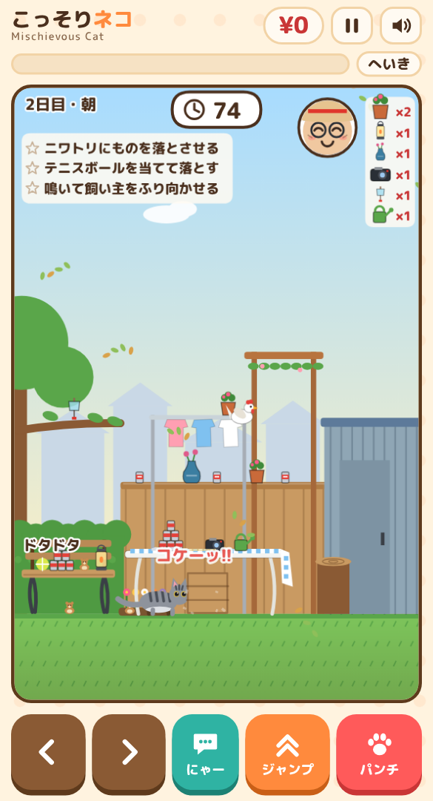 コケーッ！ ニワトリが棚へ</td>
<td align="center">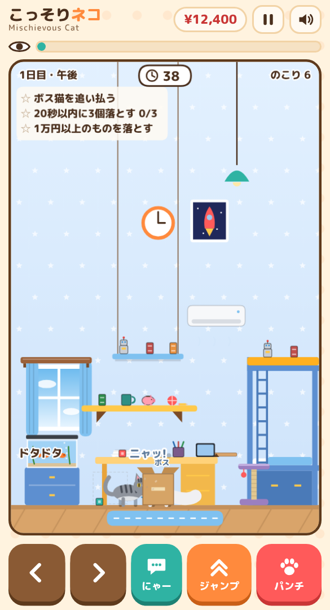 ボス猫とネコパンチ勝負</td>
<td align="center">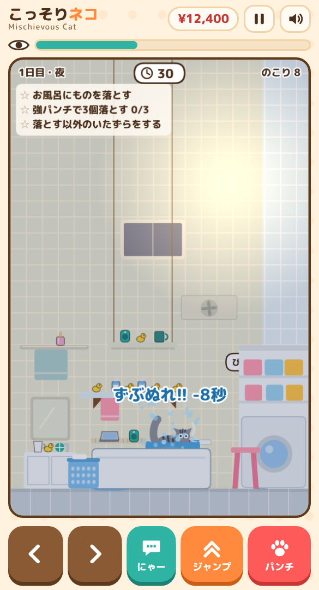 お風呂に落ちたら、ずぶぬれ</td>
</tr>
<tr>
<td align="center">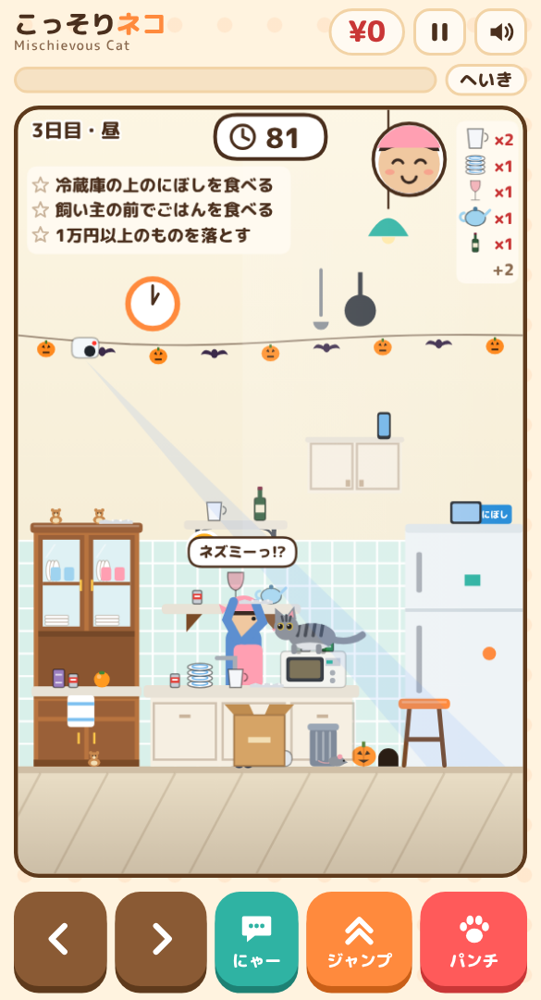 ネズミで飼い主が固まる</td>
<td align="center">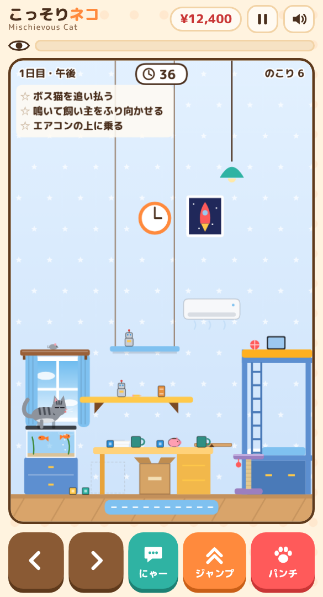 水面に来た金魚をねらう</td>
<td></td>
</tr>
<tr>
<td align="center">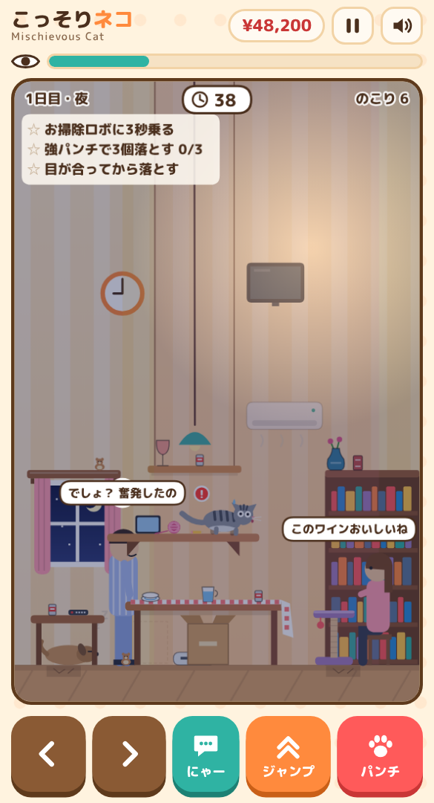 お客さんが来た夜（見張りが2人）</td>
<td align="center">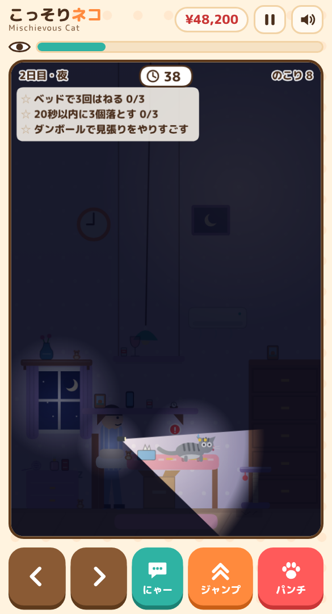 停電の夜（懐中電灯の光だけ）</td>
<td align="center">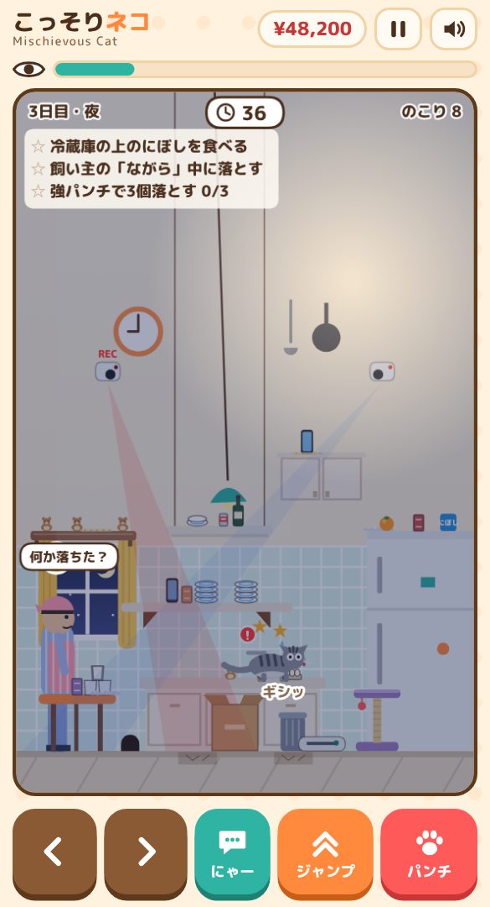 ペットカメラ作戦の夜</td>
</tr>
<tr>
<td align="center">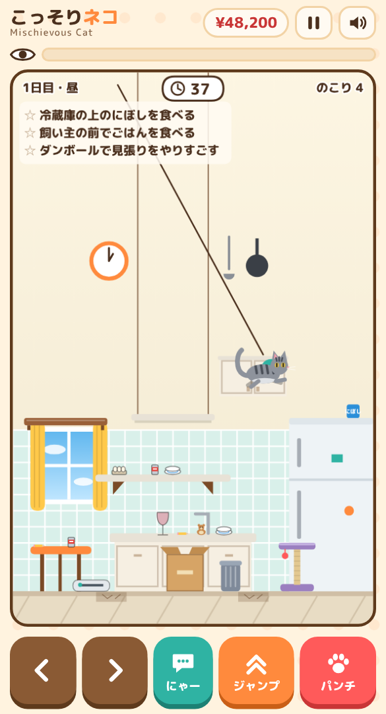 吊り照明でブランコ</td>
<td align="center">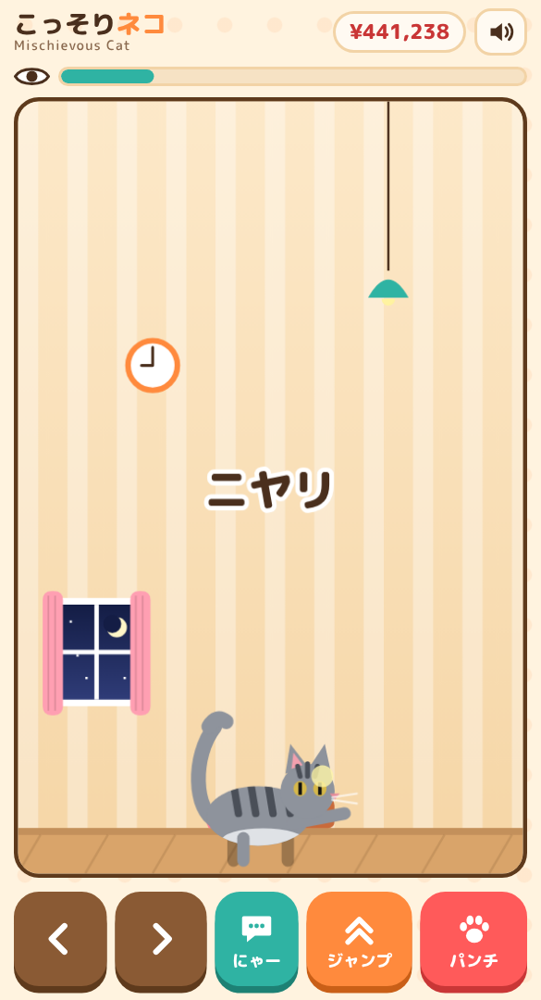 エンディング：ニヤリ</td>
<td></td>
</tr>
</table>

面が進むと、壁の高いところ（吊り棚・カーテンレール・エアコン）にも、高いものが置かれ始めます。転がる毛糸玉、爪とぎスポットなど、落とす以外の遊び方も少しずつ増えていきます。

## 🐱 ネコたち

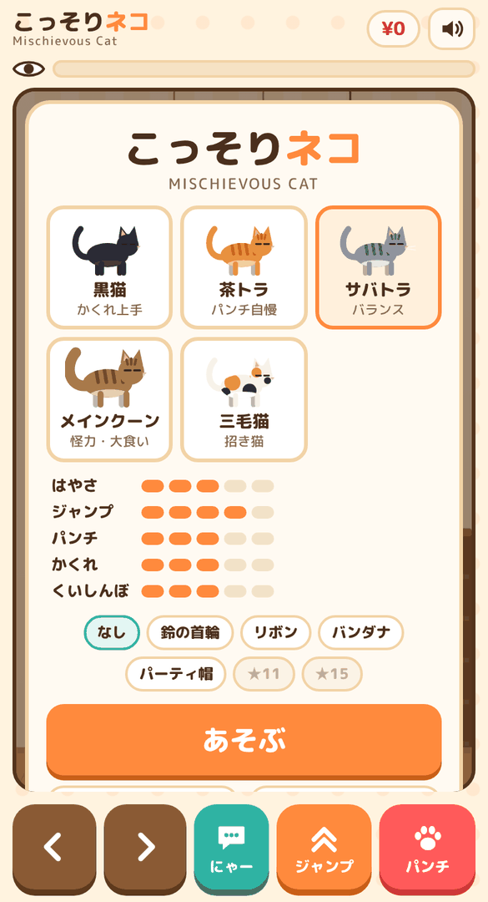

| ネコ | とくい | 仲間になる条件 |
|---|---|---|
| サバトラ | バランス型 | 最初から |
| 茶トラ | パンチ自慢 | 最初から |
| 黒猫 | 見つかりにくい | 怪しまれ度 50% 未満のまま 1 面クリア |
| メインクーン | 怪力・大食い（ジャンプは低め） | 重いもの（マグカップ・花瓶・ゲーム機）を通算 5 個落とす |
| 三毛猫 | 招き猫（高いものが置かれやすい） | 1 回のプレイで被害額 ¥100,000 超え |

## 🏆 ランキングと称号

- **みんなのランキング（総合）**：結果画面でニックネームを登録すると、遊んだ人全員の上位 50 人に載ります（1 端末 1 件）。記録を送るのは自己ベストを更新したときだけで、名前を変えたときも、次に自己ベストを更新したときから新しい名前で載ります
- **今日のランキング**：その日（日本時間）だけの順位です。記録は「総合」と「今日」の両方に、それぞれ自己ベストを更新したときに送ります
- **LINE で送る**：結果画面の「LINE で送る」は、文章とリンクを送ります（「シェア」は画像つき。LINE では画像だけになります）
- **通算記録**：タイトル画面の「通算記録」で、通算の被害額やよく割ったもの、退治したネズミの数などを見られます
- **この端末のランキング**：自分の上位 10 件
- **称号**：40 種類。取り方は秘密です。集めると、首輪・リボン・王冠などの**きせかえ**が増えます
- **犯行現場写真**：見つかった瞬間がポラロイド写真になります。SNS でシェアしてください（`#こっそりネコ`）

## ❓ よくある質問

- **お金はかかる？** かかりません。広告もありません
- **音が出ない** 右上のスピーカーのボタンを確認してください。iPhone はマナーモードだと鳴らないことがあります
- **新しくしたのに古いまま** 一度閉じて開き直してください（オフライン用に前の版が残っていることがあります）
- **データは？** 記録は端末の中に保存します。みんなのランキングに登録したときだけ、ニックネームと記録を送ります

---

## 📖 くわしいルール

数字まで知りたい人向けです。読まなくても遊べます。

### 飼い主の1日

ステージ 4 つで 1 日です（上の「1 日の流れ」の表）。夜のステージをクリアすると「○日目 おしまい」（飼い主が寝る）になり、次の日の朝に進みます。3 日目の夜をクリアするとエンディングになり、そこで終わって結果を見るか、4 日目へ続けるかを選べます。日を追うごとに難しくなります。

ステージが始まるときに「1日目 8:00 朝のリビング」のような札が出ます（とくべつな夜は夜の名前と「とくべつな夜」の札）。札の右には、その日の天気が出ます。犬はリビングと寝室、お掃除ロボはリビングとキッチンにだけ出ます。ネズミはステージ 2 から、キッチンには必ず、お風呂場以外の部屋には 40% の確率で出ます。ボス猫は子ども部屋に必ず、2 日目からはお風呂場以外の部屋にも 35% の確率で出ます。

**見張り役**：部屋ごとに見張る人が違います。

| 見張り役 | 部屋 | 見張り方 |
|---|---|---|
| 飼い主 | リビング・キッチン・お風呂場・寝室 | ふつう |
| 子ども | 子ども部屋 | 歩くのが 1.45 倍速い。見える距離は歩いているとき 150px、見回すとき 330px |
| おばあちゃん | 庭 | 歩くのは 0.7 倍。歩いている途中で、ときどき約 1 秒振り返る（「？」） |
| お父さん | 書斎 | 立ち止まると、棚の上を見上げることが多い |

**とくべつな夜**：

- **お客さんが来た夜**：本棚の前のスツールにお客さんが座っています。おしゃべり中は左側 250px が見え、スマホやワインの間は足もとしか見えません（見え始める前に「？」）。物音がすると「今の音なに？」「ネコかなあ…」と、飼い主と掛け合います。
- **停電の夜**：部屋は真っ暗です。飼い主の懐中電灯の光（向いている方へ約 200px）とネコのまわり、窓の月明かりだけが見えます。
- **ペットカメラ作戦の夜**：壁のペットカメラ 2 台が首を振って床まで見張り、罠も 4 つ置かれています。

**日を追うごとに増えるもの**：2 日目の朝〜夕方は罠が 2 つ、3 日目は罠が 3 つとペットカメラ 1 台。

### 基本

- ネコを動かして、部屋のものを前足で押して床や下の段へ落とします。ステージのものを全部落とすとクリアです。落とすたびに、そのものの値段が被害額に入ります。
- ステージごとに制限時間があります（25 秒＋もの 1 個につき 7 秒）。残り 10 秒になると時計が赤くなり、秒読みの音が鳴ります。0 になると「もう寝るよ〜」でゲームオーバーです。クリアすると、残り時間の半分（最大 20 秒）が次のステージに持ち越されます。持ち越しは 1 日の終わり（夜のクリア）で 0 に戻ります。
- 飼い主は部屋を巡回します。「？」は予告、「!!」は監視中です。怪しまれ度が 100% になると見つかってゲームオーバーです。
- 怪しまれるのは**いたずらの現場を見られたときだけ**です（現行犯）。怪しまれ度が上がると、原因の上に赤い「!」が出ます。
  - 怪しまれない：床を歩く、ジャンプする、鳴く、ごはんを食べる（ネコとして普通の行動）
  - 少しずつ上がる：テーブル・サイドテーブル・棚・本棚（冷蔵庫・タンス・ベッド）の上にいるところを見られる。止まっていても上がり、動いているともう少し速く上がる
  - 大きく上がる：パンチしているところ、ものが動いている・落ちているところを見られる
  - 証拠：割れた音を聞かれる、足跡を見られる
- まだ何もいたずらをしていないうちは、怪しまれ度は 90% で止まり、見つかりません。
- お掃除ロボにぶつかる、犬が吠える、といった物音では怪しまれ度は上がりません。飼い主がそちらを見に来るので、そのときにいたずらの現場を見られると上がります。
- 怪しまれ度は、見られていないとき（床にいるときを含む）に下がります。
- 飼い主はテーブルを確認する、棚を見上げる、スマホを見るのいずれかで止まります。スマホの間は視野が狭く、ときどき「！」の合図のあとに顔を上げます。
- 怪しまれ度が高いと「なんかおかしいな？」と探索を始めます。探索中は下がりません。
- ステージが進むと、ものが増え（最大 8 個）、飼い主の離席と予告が短く、監視が長くなります。
- 初めて遊ぶときのステージ1だけ、狙うものの上に矢印が出て、次に押すボタンが光ります。飼い主が見ているときに家具の上にいると「おりて」の標識が出ます。
- ゲームの中に説明文はありません。新しい仕掛けは、まだ使ったことがない間だけ絵の合図で知らせます（一度使うと出なくなります）。
  - いたずらの場所：近づくと紫の爪あとマークが浮かび、場所に入ると空の輪が出てパンチのボタンが光る（長押しの合図）
  - 転がるもの：そばに来ると、転がる向きに「＞＞＞」が流れ、パンチのボタンが光る
  - 壁の高い足場：まだ乗ったことがなければ、そこに置かれたものがきらきら光る
- 見つかると、飼い主のアップとネコの知らん顔の演出が入り、その瞬間の画面が「犯行現場写真」として残ります。
- 1 万円以上のものが割れると、一瞬スローになります。
- ものが割れると端末が振動します（重いものと高いものほど強く・長く）。Android は Vibration API で振動します。iPhone（Safari）は Vibration API がないため、非公式の方法（switch 付きチェックボックス）で触覚を出しています。iOS のバージョンや設定によっては振動しません。
- **BGM** は飼い主の様子で変わります。いないとき・歩いているときはのんびりしたメロディ、「？」やスマホの間は抜き足差し足の刻み、「!!」や探索の間は心臓の音と低いうなりに、追いかけっこの間は 1.5 倍速の追いかけっこの曲に切り替わります。時間帯ごとに調と速さも変わります（夜はゆっくり）。
- **ネコの動き**：着地でつぶれ、ジャンプ中は脚を前後に伸ばします。歩くと頭が上下し、しっぽをピンと立てます。ものの横では身を低くして瞳孔が開き、上の段のものを狙うとお尻をふります。しばらく止まっていると毛づくろい → あくび → 伸び → 香箱座り（Zz）の順に変わります。
- **ネコの表情**：ときどきまばたきし、片耳がぴくっと動きます。高いものを割ったあとやいたずらを終えたあとはにっこり、ごはん中はにっこりでのどを鳴らします（ゴロゴロ）。家具の上で見られると耳を倒してびっくり顔、怪しまれ度が 60% 以上だと耳を倒してしっぽを下げ、追いかけっこではしっぽをふくらませます。
- **飼い主の性格**：時間帯ごとのひとりごと、物音への反応（「ん？」「今の音…」）、目の前で割れたときの頭を抱える動き、高いものを壊されたときの専用のセリフ（「スマホがーっ!!」など）があります。夜はパジャマで、少しゆっくり歩きます。

### やることリスト（お題）

ステージごとに 3 つのお題が画面左上に出ます。「全部落とす」でクリアなのは変わらず、お題は寄り道の目標です。達成すると ★ が付き、制限時間が 5 秒増えます。★ の数は結果画面とシェア文に出ます。

お題は、その部屋の仕掛けから 1 つと、ほかからその面でできるもの 2 つが選ばれます。

| 種類 | お題 |
|---|---|
| 部屋の仕掛け | お掃除ロボに3秒乗る（リビング）／ニワトリにものを落とさせる（庭）／冷蔵庫の上のにぼしを食べる（キッチン）／金魚にタッチする・ボス猫を追い払う（子ども部屋）／パソコンのデータを消す（書斎）／お風呂にものを落とす（お風呂場）／目覚まし時計を鳴らす・ベッドで3回はねる（寝室） |
| そのほか | 目が合ってから落とす／2連鎖を出す／強パンチで3個落とす／1万円以上のものを落とす／水入りコップを割る／本棚の上のものを落とす／20秒以内に3個落とす／飼い主の前でごはんを食べる／鳴いて飼い主をふり向かせる／ダンボールで見張りをやりすごす／飼い主の「ながら」中に落とす／落とす以外のいたずらをする／毛糸玉（みかん・ボール）を当てて落とす／エアコン（吊り戸棚・パーゴラ・換気扇）の上に乗る／ノーマークで3連続落とす／ネズミをパンチで退治する |

### 飼い主の「ながら」（隙）

飼い主は部屋（時間帯）ごとに、しばらく何かに夢中になります。この間が、まとめていたずらするチャンスです。

| 時間帯 | ながら | 見える範囲 |
|---|---|---|
| リビング | 窓のほうを向いて電話（「もしもし〜」） | 左側だけ。右側は見えない |
| 庭 | 左を向いて水やり（「ジョロジョロ〜」） | 左側だけ。右側は見えない |
| キッチン | カウンターで料理（「ジュ〜」） | すぐそばだけ |
| 子ども部屋 | 子どもがゲームに夢中（「ピコピコ」） | すぐそばだけ |
| 書斎 | 本棚の前で読書（「ふむふむ」） | すぐそばだけ |
| お風呂場 | 左を向いて歯みがき（「シャカシャカ」） | 左側だけ。右側は見えない |
| 寝室 | 寝る前の読書（「あと1ページ…」） | すぐそばだけ |

### 追いかけっこ

怪しまれ度が 100% になっても、1 ステージに 1 回だけは即ゲームオーバーになりません。飼い主が「待てーっ!!」と追いかけてくるので、3 秒以内にダンボール（木箱・洗濯かご）かキャットタワー（切り株・風呂いす）の上、または本棚の上・カーテンレール・吊り棚・エアコンの上（手が届かない高さ）へ逃げ込めば「セーフ!」で助かります（怪しまれ度は 60% に戻り、飼い主は部屋を出ていきます）。間に合わない、または床から壁の棚までの高さで捕まるとゲームオーバーです。

**お守り**：ステージ 2 から、12% の確率でどこかの段に赤いお守りが置かれます。触れると拾えます（持てるのは 1 つ、時計の右に表示）。持っている間に見つかると、演出のあとでお守りを使い、そのステージの続きから再開します（怪しまれ度 25%、飼い主はいったん部屋を出る、追いかけっこもまた使える、制限時間は最低 10 秒）。時間切れには効きません。

**見つかったときの飼い主**：部屋ごとに格好が変わります（庭は麦わら帽子、キッチンは三角巾とエプロン、子ども部屋は子ども、書斎はメガネ、お風呂場は頭にタオル、寝室はパジャマとアイマスク）。

**見つかったときのネコの顔**：知らん顔・しらばっくれ・ぺろっ・絶叫・ぐすん、の 5 通りから選ばれます（時間切れのときは知らん顔）。

### ごはん（時間を増やす）

- 飼い主はときどき、床にごはん皿を置いていきます（「ごはんだよ〜」）。ネコが皿まで行くと「もぐもぐ」と食べて、制限時間が 10 秒増えます（メインクーンは 15 秒）。食べるのはいたずらではないので、見られても怪しまれません。
- 飼い主のそばで、怪しまれ度が低いうちに「にゃー」と鳴くと、おねだりになります。飼い主は「しょうがないなあ」とその場にごはんを置きます。
- ごはんは 1 ステージに 2 回までです。

### 足場

床、サイドテーブル、テーブル、キャットタワー、壁の棚、本棚の順に高くなります。本棚（冷蔵庫・タンスなど）の前の床も歩けます。キャットタワーは本棚の前、本棚の前にあります。ジャンプで登れ、降りるときは端から落ちます。テーブルから棚、棚から本棚の順に登ります。メインクーンはジャンプが低いですが、どの足場にも登れます（段差はどれも 75px 以内）。

壁の上のほうにも足場があります。ものが置かれ始めるのはステージ 3 以降です。

| 足場 | 高さ（床からの段） | 登り方 | ものが置かれる面 |
|---|---|---|---|
| 吊り棚 | 本棚とほぼ同じ | 壁の棚から | ステージ 3 から |
| カーテンレール | 本棚と同じ | 壁の棚の左端から | ステージ 4 から |
| エアコン（キッチンは吊り戸棚） | いちばん高い | 吊り棚か本棚から | ステージ 5 から |

### パンチと「にゃー」

- パンチはタップで弱、長押し（約 0.35 秒）で強です。強パンチは遠くまで届き、重いものも飛ばせますが、音が出て怪しまれます。
- 「にゃー」で鳴くと、飼い主はネコが向いている側を見ます。その隙に反対側でいたずらします。離席中・探索中・「ながら」中・追いかけっこ中は効きません。鳴き声は「にゃー」「にゃっ」「にゃお〜ん」「みゃ」「にゃにゃ」「なーお」「にゃ〜ん」「みゃ〜お」の 8 通りから毎回選ばれます。
- **カメラ目線**：ものの横で約 1 秒止まると、ネコがこちらを見つめます（「じーっ」）。そのままパンチして落とすと「確信犯」になり、そのものの値段の 50% が「精神的ダメージ」として被害額に上乗せされます。
- **連鎖**：すべっていったものが同じ段のものに当たると、相手を押し出します。落ちた衝撃でも近くのものが動きます。1 回のパンチで 2 個以上落とすと「○連鎖」になり、2 個目以降はそのものの値段の 20% が「巻き添え」として被害額に上乗せされます。

### 落とす以外のいたずら

決まった場所で止まってパンチを長押しすると、いたずらが進みます（ネコのまわりに紫の輪が出ます）。片手操作では、その場所をタップすると歩いて行って続けます。歩くとやめます。終わると被害額が入ります。クリアには関係ない寄り道です。長押しを離しても、いたずらをしていた間はパンチになりません。

いたずらをしているところを見られると、床の上でもパンチと同じくらい怪しまれます。

| 部屋 | いたずら | 場所 | かかる時間 | 被害額 |
|---|---|---|---|---|
| リビング・キッチン・寝室 | カーテンで爪とぎ | サイドテーブルの左端 | 1.4 秒 | ¥8,000 |
| リビング・書斎 | 壁紙で爪とぎ | テーブルの下の床（左側） | 1.8 秒 | ¥15,000 |
| キッチン | ゴミ箱をあさる | 床のゴミ箱 | 1.2 秒 | ¥2,500 |
| 書斎 | 書類をぐちゃぐちゃ | 机の左側の書類 | 1.2 秒 | ¥12,000 |
| 寝室 | シーツに穴をあける | ベッドの右側 | 1.6 秒 | ¥9,000 |
| 庭 | 花だんを掘る | テーブルの下の花だん | 1.4 秒 | ¥6,000 |
| 庭 | 洗濯物を落とす | 物干し竿（吊り棚の位置）の上 | 1.3 秒 | ¥7,000 |
| 子ども部屋 | 宿題をぐちゃぐちゃ | 机の左側 | 1.2 秒 | ¥5,000 |
| お風呂場 | トイレットペーパーをからから | 洗面台の左側 | 1.6 秒 | ¥3,000 |
| お風呂場 | タオルを引きずり下ろす | 壁の棚の左側 | 1.2 秒 | ¥4,000 |

### 物理ギミック

- **転がるもの**（ステージ 3 から）：毛糸玉（キッチンはみかん、書斎はボール）がどこかの段に置かれます。パンチすると転がり、同じ段のものに当たると押し出します。足場から落ちると跳ねます。これで落としたものが割れると「ストライク」で値段の 30% が上乗せされます。床を転がって飼い主の足元に行くと、飼い主がつまずいて少し立ち止まります。

### 部屋の仕掛け

- **ニワトリ**（庭）：床を歩いてえさをつつきます。ネコが走って近づく・すぐそばに着地する・パンチすると「コケーッ!!」と飛び上がり、降りた段のものを押しのけます。段の上では歩きながらものを押し、しばらくすると降りてきます。ニワトリが落としたものは「コケッコー連携」で値段の 30% が上乗せされます。鳴き声で飼い主が早く戻ってきたり振り向いたりしますが、ニワトリが動かしたものを見られてもネコは疑われません。
- **ネズミ**（ステージ 2 から。キッチンは必ず、お風呂場以外の部屋は 40% の確率）：ときどき壁の穴から出てきて、床を 6〜8 秒走り回ってから穴へ帰ります（次に出てくるまで 18〜28 秒）。出てくる直前は穴の奥で目が光ります。ネコが床で近づくと逃げますが、部屋のすみに追いつめると止まります。パンチを当てると退治で、制限時間 +4 秒と ¥2,000（腕前ボーナス）。ネズミが飼い主の足もとへ行くと、飼い主は悲鳴を上げて約 2.4 秒固まり、その間は足もとしか見えません。
- **水槽の金魚**（子ども部屋）：水槽のふたの上でじっとしていると金魚が寄ってきます。水面近くに来ると波紋が出るので、そこへパンチすると「金魚タッチ」（¥3,000、1 面 3 回まで）。外すと金魚は底へ逃げます。水がこぼれて床に水たまりができます。
- **ボス猫**（子ども部屋。2 日目からはほかの部屋にも）：左から入ってきて、置いてあるものを先に落としていきます。ボス猫が落としたものはクリアには数えますが、被害額は入りません（「ボスに取られた…」）。そのとき飼い主が見ていればボスが叱られて逃げ、見ていなければ物音でネコが疑われます。同じ段で近づくとケンカになり、ボス猫のネコパンチが当たると目を回して押し出されます。こちらのパンチを 3 回（強パンチは 2 回分）当てると逃げていき、「なわばり防衛」で制限時間 +5 秒。一度だけ戻ってきます。
- **お風呂**（お風呂場）：浴槽の真ん中はお湯です。落ちると「ずぶぬれ」で、制限時間 −8 秒、怪しまれ度 +30%、飼い主が駆けつけ、しばらくぬれた足跡が残ります。ネコはすぐに外へ飛び出します。ものがお湯に落ちると割れずに沈み（電子機器は「水没」）、値段が被害額に入ります。片手操作の自動移動は、お湯の上には降りません。

### 新しい仕掛け

- **テーブルクロス**（リビング・庭・お客さんの夜）：テーブルの右端に垂れたクロスの下で、パンチを長押し（0.9 秒）。テーブルの上のものが全部、右の端へすべり落ちます（クロス引きで値段の 30% 上乗せ）。
- **テレビ**（リビング）：リモコンを踏む・パンチする・落とすと、壁のテレビがつきます（1 面 2 回まで、8 秒）。飼い主はテレビに夢中になり、足もとしか見えません。お客さんもスマホを見始めます。
- **すりすり**：床で飼い主から 30px 以内にいて、0.4 秒じっとしていると、すりすりします。怪しまれ度が 1 秒に 14% 下がり、飼い主は立ち止まります。
- **罠**：アルミホイルは踏むと飛び上がって大きな物音（飼い主に聞かれる）。両面テープの上では歩く速さが 0.3 倍、ジャンプが 0.75 倍になります。
- **ペットカメラ**：壁のカメラが左右に首を振り、幅 90px の範囲を床まで見ています。範囲の中でいたずらしたり、ものが動いたりすると怪しまれ度が上がります（撮っている間は赤く光り「REC」）。
- **きゅうり**（ステージ 2 から、40%）：床のきゅうりに向かって近づくと、垂直に飛び上がります（ふつうのジャンプの約 2.3 倍の高さ）。
- **チュール**（ステージ 2 から）：飼い主がチュールを振っている約 4.5 秒間、床にいるネコは飼い主の方へ吸い寄せられます。たどり着くと食べて +6 秒、怪しまれ度 −30%。ボタンを連打してがまんゲージを満タンにすると止まり、飼い主はしょんぼりして 2.5 秒間足もとしか見えなくなります。
- **積み重なったもの**：お皿の山（4 枚）、コップのタワー（5 個）、缶のピラミッド（6 個）、本の塔（5 冊）。落ちるとくずれて中身が飛び散り、ひとつずつ割れます（同じ連鎖として数える）。
- **吊り照明**（ステージ 2 から。リビング・キッチン・書斎・子ども部屋・寝室）：天井から下がる照明のかさに空中で飛びつくと、ぶら下がります。左右でこいで、ジャンプで手を離すと、振れた勢いのまま飛んでいきます。
- **傾く棚**：壁の棚の端（26px 以内）にネコが乗り、その側の半分にものの重さが合計 2.4 以上あると、棚が傾いて全部すべり落ちます（1 面に何回でも。6 秒あけて）。重さが足りないと少しぐらつきます。
- **床のきしみ**（ステージ 2 から。庭とお風呂場以外）：床に 1〜2 か所、色の違う板があります。そこを走る（速さ 100 以上）と「ギシッ」と鳴って、飼い主が振り向きます。パンチを押しながら歩くと鳴りません。

### 手ごたえと演出

- ものが割れた瞬間に、一瞬止まって（0.045 秒、1 万円以上は 0.09 秒）少し寄ります。連鎖すると「2!」「3!」と数字が出ます。
- 残り 10 秒になると「ラストスパート!」。BGM が 1.25 倍速になり、画面のふちが赤く脈打ちます。残り 10 秒以内にクリアすると「ギリギリ!」で、その面の被害額の 15% が上乗せされます。
- 怪しまれ度が 65% を超えると、BGM が心臓の音に切り替わり、画面のふちが心臓に合わせて赤くなります。
- 飼い主の吹き出しは家具より手前に出ます（本棚の前でも隠れません）。

### 腕前のボーナス

出てくるものの値段の合計は、面ごとにほぼ決まっています（下の表）。何通りか置き方を試し、合計が目安に一番近い組を使います。被害額の差は、次の腕前のボーナスで付きます。

| ステージ | 1 | 2 | 3 | 4 | 5 | 6 | 7 | 8 以降 |
|---|---|---|---|---|---|---|---|---|
| 値段の合計の目安 | ¥2,500 | ¥7,000 | ¥60,000 | ¥100,000 | ¥140,000 | ¥175,000 | ¥200,000 | 1 面ごとに +¥15,000 |

三毛猫（招き猫）は目安が 1.3 倍になります。

| ボーナス | 条件 | 上乗せ |
|---|---|---|
| ノーマーク | 飼い主に、動いているところも、ネコの現行犯も見られずに落とすのが続く | 2 個目から、値段の 10% × (連続数 − 1)、最大 50% |
| 確信犯 | カメラ目線のまま落とす | 値段の 50% |
| 巻き添え | 連鎖の 2 個目以降 | 値段の 20% |
| ストライク／コケッコー連携／クロス引き | 転がるもの・ニワトリ・テーブルクロスで落とす | 値段の 30% |
| 手際 | 面クリア時 | その面の被害額 × 40% × 残り時間の割合 |
| ギリギリ | 残り 10 秒以内に面クリア | その面の被害額の 15% |
| 完全犯罪／こっそり | 面クリア時、その面の最大の怪しまれ度が 30% 未満／50% 未満 | その面の被害額の 30%／15% |

結果画面には、被害額のうち腕前のボーナスの合計も出ます。

### ものと値段

| もの | 被害額 | 特徴 |
|---|---|---|
| コップ | ¥500 | 軽い。水入りは水しぶきと水たまりができる |
| マグカップ | ¥1,500 | 重い。強パンチ向き |
| ワイングラス | ¥3,000 | 派手に割れる |
| 花瓶 | ¥10,000 | 大きな音が出る |
| ティッシュ箱 | ¥300 | 中身が散らばる |
| ペン立て | ¥800 | ペンが床に散らばる |
| タブレット | ¥80,000 | 高額 |
| ゲーム機 | ¥45,000 | 重い |
| スマホ | ¥120,000 | 最も高額 |
| お皿 | ¥2,000 | キッチンに多い |
| 目覚まし時計 | ¥3,000 | 寝室にある。割れると鳴り響く |
| リモコン | ¥3,000 | 軽くて薄い |
| 写真立て | ¥3,500 | ガラスが割れる |
| 観葉植物 | ¥4,000 | 重い。土と葉が散らばる |
| 卵 | ¥400 | キッチン。黄身が広がって滑る |
| ワインボトル | ¥8,000 | キッチン。赤ワインが広がって滑る |
| 香水 | ¥12,000 | 寝室。広がって滑る（いい匂い） |
| フィギュア | ¥30,000 | 書斎・リビング |
| 腕時計 | ¥60,000 | 小さくて軽い。金属の音 |
| ノートPC | ¥150,000 | 最も高額。重い |
| 植木鉢 | ¥1,500 | 庭。土と花が散らばる |
| たぬきの置物 | ¥8,000 | 庭。重い |
| ガーデンライト | ¥6,000 | 庭 |
| ロボのおもちゃ | ¥5,000 | 子ども部屋 |
| ブタの貯金箱 | ¥3,000 | 子ども部屋。小銭が散らばる |
| プラモデル | ¥12,000 | 子ども部屋。軽い |
| シャンプー | ¥1,500 | お風呂場。中身が広がって滑る |
| 防水スピーカー | ¥9,000 | お風呂場 |
| お皿の山 | ¥2,000 × 4 枚 | キッチン。くずれて 1 枚ずつ割れる |
| コップのタワー | ¥500 × 5 個 | お客さんの夜・ペットカメラの夜 |
| 缶のピラミッド・本の塔 | 小物 | くずれて散らかる（散らかし） |

**高いものほど音が大きい**：割れたときの物音は、ものごとの元の値と、値段で決まる値（0.4 + 0.45 × log10(値段 ÷ 1,000 円)）の大きいほうです。スマホは 1.34、ノートPC は 1.38 になります。飼い主がいないときに割っても、物音は聞かれます。

**飼い主は高いものを気にする**：見回りの立ち止まり先は、半分の確率で「残っている一番高いもの（1 万円以上）の前」になります。「？」で向く方向も、値段が高いものほど選ばれやすくなります（重みは値段の平方根）。

### 水たまり、障害物

- 水たまりの上ではネコが滑ります。ぬれた足で歩くと足跡が残り、飼い主が見ると怪しまれます。
- ダンボールの中（床）とキャットタワーの上は、飼い主から見えません。ダンボールは箱の幅いっぱいまで隠れられます。
- お掃除ロボ（ステージ 2 から）に床で当たると、動けなくなって怪しまれます。上に飛び乗ると、そのまま乗って移動できます。乗っている間は ＜ ＞ でロボの向きを変えられます（床の上なので怪しまれません）。降りるときはジャンプします。
- 犬（ステージ 4 から）は寝ています。近くで動いたり、近くで大きな音を出したりすると吠え、飼い主が駆けつけます。

### ネコの種類

最初に選べるのはサバトラと茶トラだけです。ほかの 3 匹は条件を満たすと解禁され、それまでは選択画面にシルエットと短い条件が出ます。

| ネコ | 解禁の条件 |
|---|---|
| 黒猫 | 怪しまれ度を 50% 未満に保ったまま、1 ステージをクリアする（こっそりクリア） |
| メインクーン | 重いもの（マグカップ・花瓶・ゲーム機）を通算 5 個落とす |
| 三毛猫 | 1 回のプレイで被害額 ¥100,000 を超える |

選択画面に、はやさ・ジャンプ・パンチ・かくれ・くいしんぼの 5 段階の目盛りを出します。

| ネコ | はやさ | ジャンプ | パンチ | かくれ（怪しまれやすさ） | ごはん | その他 |
|---|---|---|---|---|---|---|
| 黒猫 | 1.00 | 1.00 | 0.90 | 0.60（見つかりにくい） | 10 秒 | |
| 茶トラ | 1.08 | 1.00 | 1.35 | 1.05 | 10 秒 | |
| サバトラ | 1.04 | 1.05 | 1.10 | 0.85 | 10 秒 | 極端な弱点がない |
| メインクーン | 0.95 | 0.85 | 1.60 | 1.15（体が大きく目立つ） | 15 秒 | |
| 三毛猫 | 1.00 | 1.00 | 0.95 | 1.00 | 10 秒 | 招き猫：高いもの（ワイングラス・花瓶・スマホ・タブレット・ゲーム機）が置かれやすい |

数値は基準を 1 とした倍率です。かくれの列は、見られたときの怪しまれ度の上がり方で、小さいほど見つかりにくくなります。

### きせかえ

称号を集めると、ネコのきせかえが増えます。タイトル画面で選ぶと、ゲーム中の絵とシェア画像にも反映されます。

| きせかえ | 必要な称号の数 |
|---|---|
| 鈴の首輪 | 2 |
| リボン | 4 |
| バンダナ | 6 |
| パーティ帽 | 8 |
| メガネ | 11 |
| 王冠 | 15 |

### ポーズ

画面右上の一時停止ボタン（PC は Esc か P）でポーズします。ポーズ中は「つづける」「やりなおす」「トップへ」と音の切り替えを選べます。別のアプリやタブに切り替えると自動でポーズします。

### 結果とシェア

数字は被害額だけです（スコアはありません）。ゲームオーバーで「本日の被害額」と称号を表示し、シェア用の画像（1200×630）を作ります。画像には、見つかった瞬間の画面をポラロイド写真のように貼り、被害額、ステージ、称号、飼い主のひとことを載せます。「シェア」は端末の共有画面（Web Share API）を開き、使えない環境では X の投稿画面を開きます。「保存」で PNG を保存できます。ハッシュタグは `#MischievousCat` と `#こっそりネコ` です。

称号は 40 種類あり、タイトル画面の「称号図鑑」で集めた数を見られます。まだ取っていない称号は「？？？」と表示します。結果画面の大きな称号は、1 プレイの被害額で決まります。

| 被害額 | 称号 |
|---|---|
| ¥10,000 未満 | 見習いネコ |
| ¥60,000 未満 | 食器破壊職人 |
| ¥200,000 未満 | キッチンの悪夢 |
| ¥500,000 未満 | リビング崩壊請負猫 |
| ¥500,000 以上 | 伝説の食器破壊者 |

ほかに、プレイ内容で取れる称号が 25 種類あります（取り方はゲームでは見せていません）。

| 称号 | 条件（1 プレイの中で） |
|---|---|
| スマホ破壊神 | スマホを 2 台落とす |
| 水難の相 | 水入りコップを 3 個割る |
| 確信犯 | 確信犯で 3 個落とす |
| お題マスター | 1 回のプレイで ★ を 9 個集める |
| 逃げ足の達人 | 追いかけっこで 2 回逃げ切る |
| お掃除ロボ乗り | ロボに合計 8 秒乗る |
| ピタゴラ職人 | 3 連鎖以上 |
| 堂々と寝る犯人 | 家具の上で止まっているときに見つかる |
| 紙吹雪の演出家 | ティッシュ箱を 3 個落とす |
| 足跡アーティスト | 足跡を 40 個残す |
| 番犬の天敵 | 犬に 3 回吠えられる |
| 本棚の主 | 本棚の上のものを 3 個落とす |
| 秒殺 | ステージ 2 以降を 15 秒未満でクリア |
| ただの良いネコ | 被害額 ¥0 のまま時間切れ |
| くいしんぼう | ごはん・おやつを合わせて 3 回食べる |
| 一日中いたずら | 1 日（夜のステージ）を乗り切る |
| 在宅勤務の敵 | 書斎のデータを消す |
| 目覚まし係 | 目覚まし時計を鳴らす |
| 爪とぎ職人 | 落とす以外のいたずらを 3 つする |
| テーブルクロスの達人 | テーブルクロスを引く |
| あざといネコ | 飼い主に合計 5 秒すりすりする |
| きゅうり恐怖症 | きゅうりで飛び上がる |
| 空中ブランコ | 吊り照明から飛ぶ |
| 自称いい子 | エンディングを見る |
| ネズミ作戦の参謀 | ネズミで飼い主を 2 回びっくりさせる |
| ボウリング王 | 転がるもので当てたものを 3 個割る |
| 天井の住人 | エアコン（吊り戸棚）の上に乗る |
| ノーマークの達人 | ノーマークで 5 連続落とす |
| 完全犯罪 | 完全犯罪（最大の怪しまれ度 30% 未満）で 3 面クリア |
| 踊るネコ | ネコが踊る（3 連鎖以上か、10 万円以上のものを割る） |

### ランキング

「ランキング」画面には2つのタブがあります。タイトル画面と結果画面から開けます。

- **みんな**：遊んだ人全員の上位50人です（1人1件、その人の一番よい記録）。初めて記録が出たとき、結果画面でニックネーム（10文字まで）を入れて「登録」を押すと載ります。2回目からは自動で送ります。名前は「みんな」タブで変えられます。
- **この端末**：この端末で出した上位10件です（被害額、ステージ、★、ネコ、日付、うち腕前のボーナス）。

### 操作のくわしい表

#### かたて操作

タイトル画面かポーズで「かたて操作」を ON にすると、下のボタンを隠して、ゲーム画面のタップとスワイプだけで遊べます。

| 操作 | かたて操作 |
|---|---|
| 歩く | 行きたい場所をタップ |
| パンチ | ものをタップ（そのものの横まで歩いてからパンチ）。長押ししてから離すと強パンチ |
| ジャンプ | 上へスワイプ（斜めにスワイプすると、その向きへ跳ぶ） |
| 鳴く | ネコをタップ |

#### ボタン・キー

| 操作 | PC | スマホ |
|---|---|---|
| 左右に移動 | ← → / A D | 画面下の ＜ ＞ |
| ジャンプ | ↑ / W | ジャンプ |
| パンチ（長押しで強パンチ） | Space / Z | パンチ |
| 鳴く | X | にゃー |
| ポーズ | Esc / P | 画面右上の一時停止 |
| 音の ON / OFF | M | 画面右上のスピーカー |
